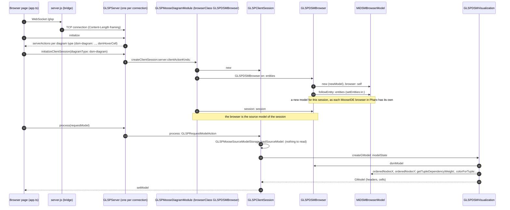
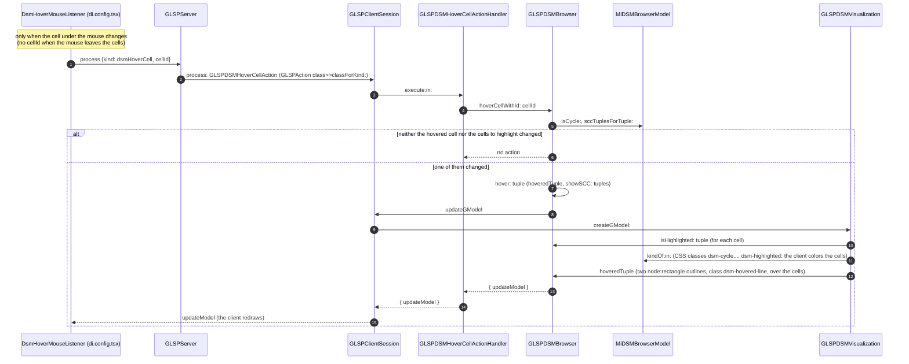
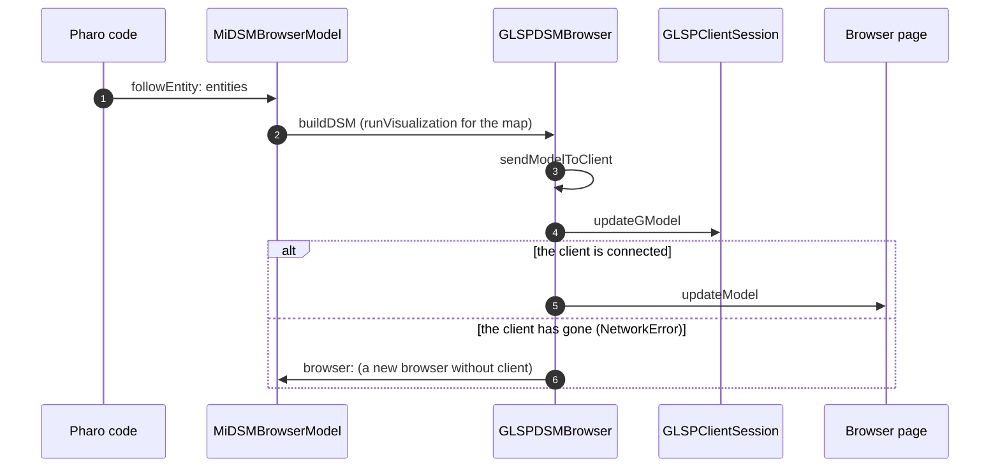

# The MooseIDE GLSP diagrams

Two MooseIDE visualizations are served by the Pharo GLSP server of [Pharo-GLSP](https://github.com/NicolasAnquetil/Pharo-GLSP) and shown by
its [`browser-client/`](https://github.com/NicolasAnquetil/Pharo-GLSP/tree/main/browser-client) in a web browser:

- the **architectural map** (`archmap-diagram`): the root packages of a model, with the dependencies between them;
- the **DSM** (`dsm-diagram`): the dependency structure matrix of these packages; hovering a cell outlines its
  column and its row with a thick border, and for a cell of a cycle shows its whole strongly connected component
  (SCC) in red.

Both are read-only, except that the nodes of the architectural map can be moved (as in Roassal), and both use the MooseIDE models unchanged (`MiArchitecturalMapModel`, `MiDSMBrowserModel`):
on the GLSP side, a *GLSP browser* takes the place of the Spec browser of MooseIDE.

## Where the code is

| What | Where |
|---|---|
| GLSP server (protocol, sessions, actions, GModel) | [Pharo-GLSP](https://github.com/NicolasAnquetil/Pharo-GLSP), `src/` (`GLSP-Server`, ...) |
| Browser client and WebSocket ⇄ TCP bridge | [Pharo-GLSP](https://github.com/NicolasAnquetil/Pharo-GLSP), `browser-client/` |
| The two diagrams | this repository (MooseIDE), for now in the `development` branch of [NicolasAnquetil/Midas](https://github.com/NicolasAnquetil/Midas) |
| — common classes | package `MooseIDE-Visualization`, tag `GLSP` |
| — architectural map | package `MooseIDE-ArchitecturalMap`, tag `GLSP` |
| — DSM | package `MooseIDE-DSM`, tag `GLSP` |
| — tests | package `MooseIDE-Tests`, tag `Browsers`: `GLSPMooseDiagramModuleTest`, `GLSPArchitecturalMapBrowserTest`, `GLSPDSMBrowserTest`, `GLSPDSMVisualizationTest` (with `GLSPTestServer`, a fake server keeping what is sent to the client) |

The MooseIDE baseline declares Pharo-GLSP as the project `GLSP`, loaded by the group `glsp`.

## The classes

The organisation mirrors the one of MooseIDE, where a Spec browser (`MiDSMBrowser`) shows a model
(`MiDSMBrowserModel`) drawn by a Roassal visualization (`MiDSMVisualization`):

| Role | MooseIDE (Spec, Roassal) | GLSP: common | GLSP: architectural map | GLSP: DSM |
|---|---|---|---|---|
| model | MiArchitecturalMap-Model, MiDSMBrowserModel | (unchanged) | | |
| browser: the model's `browser`, receives its callbacks and the client's | MiArchitecturalMap-Browser, MiDSMBrowser | GLSPMooseBrowser | GLSPArchitecturalMap-Browser | GLSPDSMBrowser |
| visualization: draws the model (the GLSP *GModel factory*) | MiArchitecturalMap-Visualization, MiDSMVisualization | (GLSPGModelFactory) | GLSPArchitecturalMap-Visualization | GLSPDSMVisualization |
| diagram module: defines a diagram type for the GLSP server | — | GLSPMooseDiagramModule (one class, its browserClass says the diagram) | | |
| storage: required by GLSP, reads nothing, refuses to save | — | GLSPMooseSourceModel-Storage | | |
| action sent by the client, and its handler | — | | GLSPArchitecturalMap-ChangeBoundsHandler (standard changeBounds) | GLSPDSMHoverCellAction (custom), GLSPDSMHoverCellAction-Handler |

What each part does:

- **`GLSPMooseDiagramModule`** is one class for every diagram: it holds the entities to show and its
  `browserClass`. For each client session it creates a browser (`browserClass`) with its own model of these
  entities, as each MooseIDE browser in Pharo has its own model: each displayed diagram has its model. What is
  specific to a diagram, it asks the class side of its browser class: `diagramType`, `gmodelFactory` (the
  visualization), `actionHandlers` (the DSM's hover handler, the map's move and select handlers) and the type hints
  (`shapeTypeHints`, `edgeTypeHints`; `nil` for GLSP's defaults, the map's say its nodes can only be moved). The
  diagrams are read-only: `createActionHandlers` gives the sessions only the requests of the model, the type hints
  and the context actions, then the diagram's handlers; no operations, undo, redo or save, so the client is not told
  it can send them.
- **The browser class side** also builds the module (`GLSPMooseBrowser class>>diagramModuleOn: entities`) and serves
  it alone (`serve:onPort:`); the architectural map can also open in a Bloc editor of the image (`openOn:`).
- **`GLSPMooseBrowser`** is one per client session (plus one *without client*, see below). It is
  - the **browser of the model**: the model calls it back (`buildDSM` for the DSM, `runVisualization` for the map,
    `updateToolbar`, `application`); after a change of the model it sends the model again to its client
    (`sendModelToClient`);
  - the **source model of its session**: the visualization draws the model from it (`dsmModel`, `mapModel`);
  - the receiver of the **client's callbacks**: `GLSPDSMBrowser>>hoverCellWithId:`, which keeps the hovered cell
    of its client (its column and row are outlined) and shows its SCC (`showSCC:`, as `MiDSMBrowser`).
- **A browser without client**: MooseIDE models need a browser. `GLSPMooseBrowser class>>on:` builds a browser
  with its own model and no session (its callbacks do nothing) until the diagram module gives it its session;
  `modelOn:` answers such a model. When a client has gone, its browser gives the model a new browser without client
  (`detachFromModel`).

## Running

In Pharo, one GLSP server for both diagrams:

```smalltalk
entities := MooseModel root allModels first allModelPackages.
launcher := GLSPMooseDiagramModule
	serveAll: { GLSPArchitecturalMapBrowser diagramModuleOn: entities. GLSPDSMBrowser diagramModuleOn: entities }
	onPort: 5007.
"... later"
launcher stop.
```

One diagram alone: `GLSPDSMBrowser serve: entities onPort: 5007`.

In `browser-client/` of Pharo-GLSP: `npm install` once, then `node server.js` (bridge on port 8080 to the GLSP server on 5007), and open
http://localhost:8080/ (architectural map) or http://localhost:8080/?diagram=dsm (DSM).
`node test-bridge.js` or `node test-bridge.js dsm` checks the bridge and the Pharo server without a browser.

## Opening a diagram

The browser page opens a WebSocket on the bridge, which opens one TCP connection to the Pharo server; for each
connection the launcher creates a `GLSPServer` with copies of the diagram modules (they share the entities; each session builds its own model).



The architectural map is opened the same way, with `GLSPArchitecturalMapBrowser` as browser class, `MiArchitecturalMapModel` and `GLSPArchitecturalMapVisualization` (which lets
`MiArchitecturalMapBuilder` and Roassal size and place the nodes).

## Hovering a DSM cell (callback from the client)



## A change of the model in Pharo (callback from the model)

For instance `model followEntity: otherEntities` on the DSM, or `updateFromConfiguration:` on the map. Each session
has its own model (`session modelState sourceModel model`): the change goes to that session's client only.



## Moving a node of the architectural map

The client sends GLSP's standard operation `changeBounds`. What the user can do with each element type is told by
the server with **type hints** (`GLSPArchitecturalMapBrowser class>>shapeTypeHints`, `edgeTypeHints`): the nodes can
only be moved (not resized, deleted or reparented), the dependencies cannot be edited (they follow their nodes).

- `GLSPArchitecturalMapChangeBoundsHandler` gives the new positions to the browser of the session
  (`moveNodeWithId:to:`), which keeps them (`movedPositions`, one browser per client: each client its own positions);
  `GLSPArchitecturalMapVisualization` puts a moved node where the user put it, the others where the layout puts them.
- It is an action handler, not an operation handler: GLSP-Server records operations for undo by copying the source
  model (`GLSPRecordingCommand`, `veryDeepCopy`), here the browser, with the map model and the Moose model behind it.
  As in Roassal, a move cannot be undone.
- A change of the map (`runVisualization`, after `updateFromConfiguration:`) lays out all the nodes again, as in Roassal.

## Selecting nodes of the architectural map

Selecting is done by the client (click, Ctrl/Cmd+click to add or remove a node, Ctrl/Cmd+A, Shift+drag for a box, a
click on the background to deselect). It tells the server with GLSP's standard actions `elementSelected`
(`GLSPSelectAction`) and `allSelected` (`GLSPSelectAllAction`), which the client sends because the server announces
them.

- `GLSPArchitecturalMapSelectHandler` keeps the selection in the map model: `MiArchitecturalMapModel>>selectedEntities`.
  Its `miSelectedItem` answers the selected entities, or all its entities when none is selected (as
  `MiAbstractVisualizationBrowser>>miSelectedItem` does with the Roassal canvas). New entities (`entities:`) clear the
  selection.
- `GLSPArchitecturalMapVisualization` sends the nodes of the selected entities with the standard GModel property
  `selected`, so that a model sent again (after a move, a change of the map) still shows the selection.

## Notes for maintenance

- The server sends what the elements are, not how they look (native GLSP): types and CSS classes, no colors. The
  DSM colors (those of `MiDSMBrowserModel>>initializeColors`) and the outlines of the hovered column and row are in
  the client (`browser-client/index.html` of Pharo-GLSP).

- MooseIDE changes are committed to the `development` branch of the Midas fork (`git push midas development`).
  Its test workflow runs on pull requests only.
- Exporting the MooseIDE repository from Iceberg also rewrites files of unrelated packages (`.project`,
  `Famix-CriticBrowser*`, `MooseIDE-ButterflyMap-Tests`, `MooseIDE-Spotter*`): restore them before committing.
- After changing the Pharo side, restart the GLSP server (the running one keeps its modules and model), then
  reload the page; after changing `browser-client/`, restart `node server.js` (it rebuilds the client).
- The client must know the element types of a diagram (views in `browser-client/src/di.config.tsx`) and its name
  (`browser-client/src/app.ts`). A new diagram: a `GLSPMooseBrowser` subclass (its class side says `diagramType`,
  `gmodelFactory`, `actionHandlers` and the type hints), a visualization (`GLSPGModelFactory` subclass), and its views in the client.
